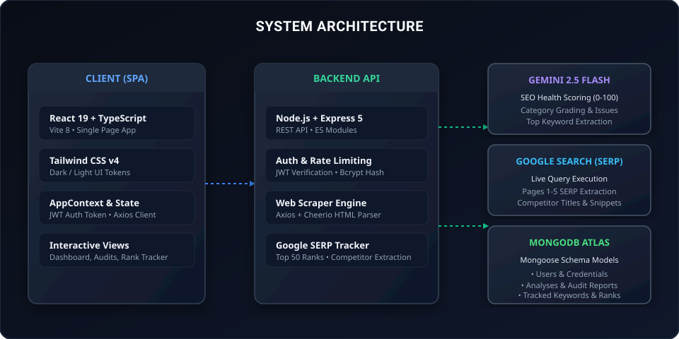
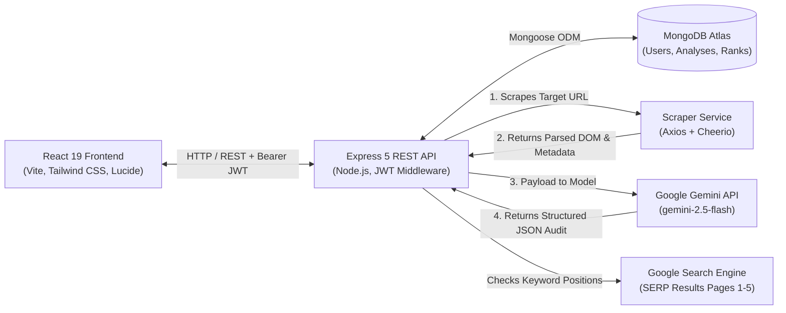
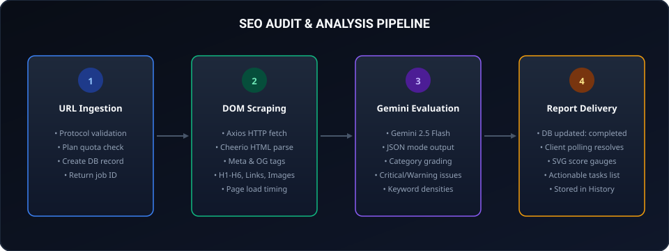
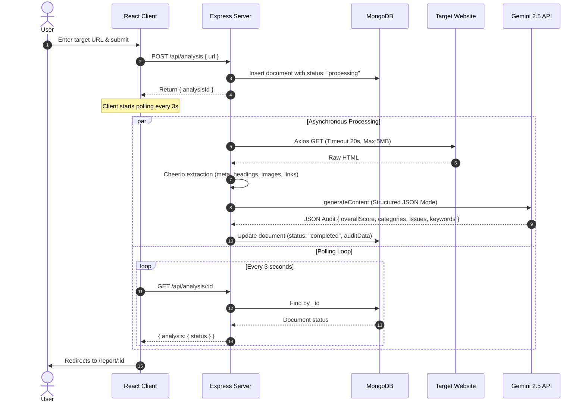
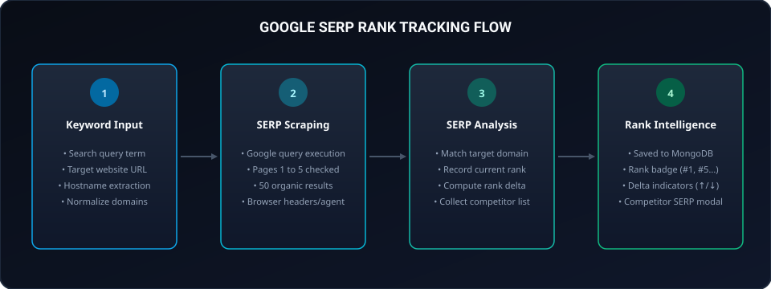
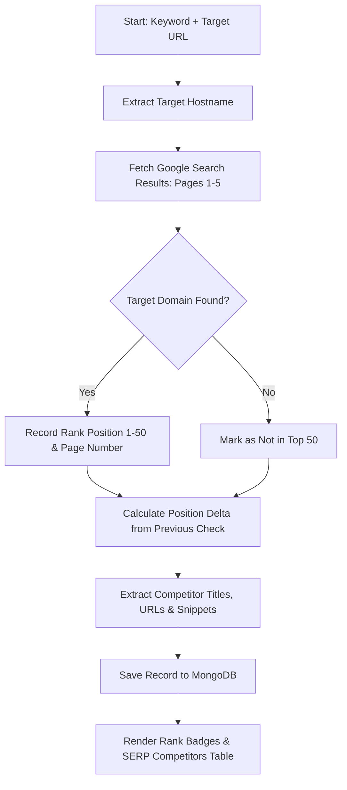
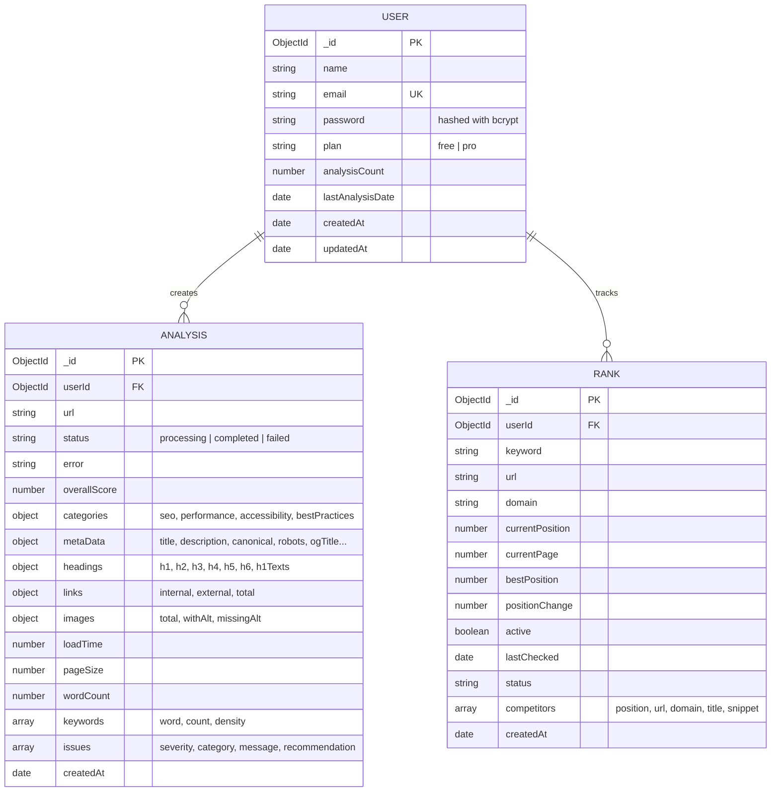

# Rank Pilot — SEO Audit & Google Keyword Rank Tracker

A full-stack web application for crawling websites, generating diagnostic SEO audits via Google Gemini, and tracking organic Google SERP keyword rankings against competitors.

[](https://react.dev/)
[](https://www.typescriptlang.org/)
[](https://vitejs.dev/)
[](https://tailwindcss.com/)
[](https://nodejs.org/)
[](https://expressjs.com/)
[](https://www.mongodb.com/)
[](https://ai.google.dev/)
[](LICENSE)

---

## Table of Contents

- [Overview](#overview)
- [System Architecture](#system-architecture)
- [Core Workflows](#core-workflows)
  - [1. Website Scraping & SEO Auditing](#1-website-scraping--seo-auditing)
  - [2. Google SERP Rank Tracking](#2-google-serp-rank-tracking)
- [Database Schema (ERD)](#database-schema-erd)
- [Project Structure](#project-structure)
- [Tech Stack](#tech-stack)
- [Getting Started](#getting-started)
  - [Prerequisites](#prerequisites)
  - [Backend Setup](#backend-setup)
  - [Frontend Setup](#frontend-setup)
- [API Endpoints](#api-endpoints)
- [License](#license)

---

## Overview

Rank Pilot provides two primary utilities in a unified dashboard:

1. **Website SEO Audits:** Accepts any URL, executes a server-side scrape using Cheerio and Axios to extract raw DOM elements, page size, load speed, and metadata, then passes the structured payload to the Gemini API (`gemini-2.5-flash`) for category scoring (SEO, Performance, Accessibility, Best Practices), keyword frequency extraction, and prioritized remediation suggestions.
2. **Google SERP Rank Tracking:** Queries Google search across pages 1 to 5 (top 50 results) for specific target keywords, calculates position deltas against historical rankings, and aggregates competitor SERP titles, URLs, and snippets.

---

## System Architecture





---

## Core Workflows

### 1. Website Scraping & SEO Auditing

The audit process runs asynchronously to eliminate client request timeouts during scraping and AI evaluation:





#### What Gets Scraped:
- **Meta Tags:** Title tag length, meta description length, canonical URL, robots meta, Open Graph tags, Twitter Card tags, viewport, charset.
- **Headings:** Count of `H1` through `H6`, and text content of first 5 `H1` tags.
- **Links:** Internal link count, external link count, and total link volume.
- **Images:** Total image count, images with `alt` text, images missing `alt` attributes.
- **Content:** Load duration (ms), total page size (bytes), word count, and extracted body text.

---

### 2. Google SERP Rank Tracking

The rank tracker queries Google search results across pages 1 to 5 to find where the target domain ranks for a specific query:





---

## Database Schema (ERD)



---

## Project Structure

```text
seo-rank-tracker/
├── client/                     # Frontend Application
│   ├── src/
│   │   ├── components/         # Reusable UI Components
│   │   │   ├── AnalysesCard.tsx# Scan history cards
│   │   │   ├── IssueCard.tsx   # Categorized SEO recommendations
│   │   │   ├── Navbar.tsx      # Main navigation & theme switch
│   │   │   ├── ProtectedRoute.tsx # Route authentication guard
│   │   │   └── ScoreGauge.tsx  # Dynamic SVG circular score visualizer
│   │   ├── context/
│   │   │   ├── AppContext.tsx  # Auth state, login/logout, Axios instance
│   │   │   └── ThemeContext.tsx# Dark/Light theme state
│   │   ├── pages/
│   │   │   ├── Analyze.tsx     # URL submission & real-time progress steps
│   │   │   ├── Dashboard.tsx   # User metrics, quick scan & recent audits
│   │   │   ├── History.tsx     # Paginated audit list with search & filter
│   │   │   ├── Home.tsx        # Public landing view
│   │   │   ├── Login.tsx       # Auth forms (sign in / sign up)
│   │   │   ├── RankDetail.tsx  # Deep dive into keyword competitors
│   │   │   ├── RankTracker.tsx # Google keyword ranking dashboard
│   │   │   └── Report.tsx      # Complete SEO audit report view
│   │   ├── App.tsx             # Route declarations
│   │   └── main.tsx            # Application entry point
│   └── package.json
│
├── server/                     # Backend API Microservice
│   ├── config/
│   │   └── db.js               # MongoDB connection setup
│   ├── controller/
│   │   ├── analysisController.js # Scraping logic & Gemini API handler
│   │   ├── authcontroller.js   # User registration, login & profile
│   │   └── rankController.js   # Google SERP scraping & position parsing
│   ├── middleware/
│   │   └── auth.js             # JWT bearer verification middleware
│   ├── model/
│   │   ├── analysisModel.js    # Audit document schema
│   │   ├── model.js            # User credentials & tier schema
│   │   └── rankModel.js        # Keyword & SERP competitor schema
│   ├── routes/
│   │   ├── analysisRoutes.js   # /api/analysis routes
│   │   ├── authRoutes.js       # /api/auth routes
│   │   └── rankRoutes.js       # /api/rank routes
│   ├── server.js               # Express application entry point
│   └── package.json
│
└── docs/
    └── diagrams/               # Architecture and data pipeline SVG diagrams
```

---

## Tech Stack

| Component | Technology | Usage |
|---|---|---|
| **Frontend Framework** | React 19 + TypeScript | UI layer, state hooks, and type safety |
| **Build Tooling** | Vite 8 | Fast dev server and client build orchestration |
| **Styling** | Tailwind CSS v4 | CSS utility tokens and dark/light color scheme |
| **Icons** | Lucide React | Clean, scalable vector icons |
| **Routing** | React Router v7 | Client-side routing, protected routes, and redirects |
| **Notifications** | React Hot Toast | User toast alerts for async events |
| **Backend Framework** | Node.js + Express 5 | RESTful API server with ES Modules |
| **Database** | MongoDB Atlas + Mongoose 9 | Document storage for users, audits, and rank tracking |
| **Web Scraping** | Axios + Cheerio | Fast HTTP fetching and server-side DOM traversing |
| **AI Evaluation** | `@google/generative-ai` | SEO diagnostics with fallback support (`gemini-2.5-flash`) |
| **Auth & Security** | JWT + `bcrypt` | Token-based authorization and secure password hashing |

---

## Getting Started

### Prerequisites
- **Node.js** (v18.0.0 or higher)
- **npm** (v9.0.0 or higher)
- **MongoDB Atlas** cluster connection URI (or local MongoDB)
- **Google Gemini API Key** from [Google AI Studio](https://aistudio.google.com/)

---

### Backend Setup

1. Open your terminal and enter the `server` directory:
   ```bash
   cd server
   npm install
   ```

2. Create a `.env` file inside `server/`:
   ```env
   PORT=5000
   JWT_SECRET=your_jwt_secret_key
   mongodb_uri=mongodb+srv://<username>:<password>@cluster0.mongodb.net/seo
   GEMINI_API_KEY=your_gemini_api_key
   GEMINI_MODEL=gemini-2.5-flash
   ```

3. Start the backend:
   ```bash
   npm run dev
   ```
   *The server runs at `http://localhost:5000`.*

---

### Frontend Setup

1. In a new terminal window, navigate to the `client` directory:
   ```bash
   cd client
   npm install
   ```

2. Create a `.env` file inside `client/`:
   ```env
   VITE_BACKEND_URL=http://localhost:5000
   ```

3. Launch the client:
   ```bash
   npm run dev
   ```
   *The client runs at `http://localhost:5173`.*

---

## API Endpoints

### 🔐 Auth (`/api/auth`)
| Method | Endpoint | Description | Auth |
|---|---|---|:---:|
| `POST` | `/api/auth/register` | Create a new user account | No |
| `POST` | `/api/auth/login` | Log in and receive JWT token | No |
| `GET` | `/api/auth/user` | Get profile of logged-in user | Yes |

### 🔍 Analysis (`/api/analysis`)
| Method | Endpoint | Description | Auth |
|---|---|---|:---:|
| `POST` | `/api/analysis` | Queue a website scan & AI audit (`{ url }`) | Yes |
| `GET` | `/api/analysis` | Fetch paginated scan history (`?page=1&limit=20`) | Yes |
| `GET` | `/api/analysis/:id` | Get status and report for an audit ID | Yes |
| `DELETE`| `/api/analysis/:id` | Delete an audit record | Yes |

### 📈 Rank Tracker (`/api/rank`)
| Method | Endpoint | Description | Auth |
|---|---|---|:---:|
| `POST` | `/api/rank` | Track a keyword + target URL (`{ keyword, url }`) | Yes |
| `GET` | `/api/rank` | Retrieve all tracked keywords | Yes |
| `GET` | `/api/rank/:id` | Fetch keyword details & competitor list | Yes |
| `POST` | `/api/rank/:id/refresh` | Re-scrape live Google SERP for keyword | Yes |
| `DELETE`| `/api/rank/:id` | Remove a tracked keyword | Yes |

---

## License

This project is licensed under the [ISC License](LICENSE).
