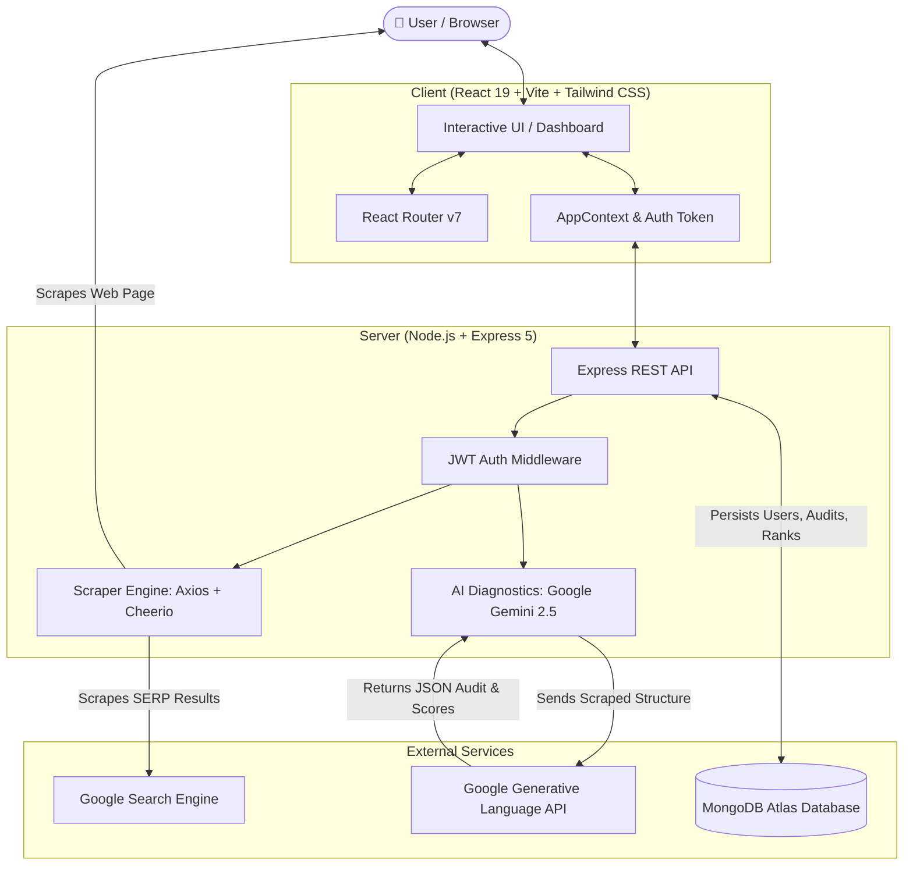
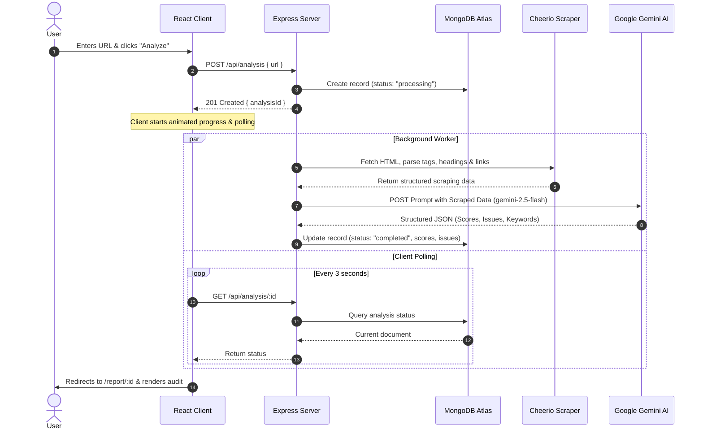
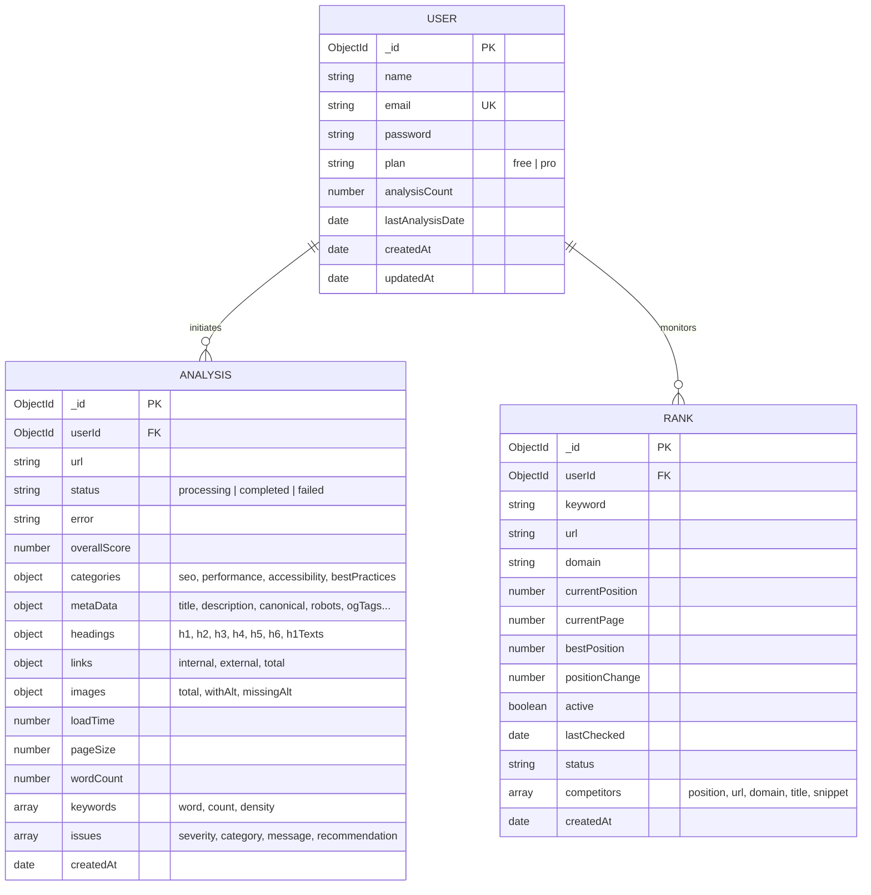

#  Rank Pilot — AI-Powered SEO Analyzer & Rank Tracker

<div align="center">


**An intelligent, full-stack SEO platform that delivers comprehensive AI-driven website audits and real-time Google SERP rank tracking.**

[](https://react.dev/)
[](https://www.typescriptlang.org/)
[](https://vitejs.dev/)
[](https://tailwindcss.com/)
[](https://nodejs.org/)
[](https://expressjs.com/)
[](https://www.mongodb.com/)
[](https://ai.google.dev/)
[](LICENSE)

[Features](#-key-features) • [Architecture](#-architecture--data-flow) • [Screenshots](#-product-previews) • [Getting Started](#-getting-started) • [API Reference](#-api-reference)

</div>

---

## 📖 Overview

**Rank Pilot** empowers developers, digital marketers, and SEO professionals to audit websites and monitor search engine visibility with speed and precision.

Instead of generic heuristic scans, **Rank Pilot** uses high-speed web scraping via **Cheerio** combined with the cognitive capabilities of **Google Gemini (2.5 Flash)** to analyze technical structure, metadata, headings, content quality, and performance factors. It scores each domain across 4 primary pillars, extracts keyword densities, identifies critical vulnerabilities with actionable remediation steps, and tracks Google SERP rankings against live competitors.

---

## 🌟 Key Features

### 🔍 1. AI-Driven SEO Auditing
- **Instant Web Scraping:** Extracts page size, load times, HTTP status, meta descriptions, canonicals, Open Graph/Twitter cards, heading hierarchies (`H1`–`H6`), and images missing `alt` attributes.
- **Cognitive Diagnostics:** Evaluates websites across 4 key categories: **SEO**, **Performance**, **Accessibility**, and **Best Practices** (0–100 score).
- **Prioritized Action Plan:** Classifies issues into **Critical**, **Warning**, and **Info** tiers with step-by-step developer recommendations.
- **Keyword Density Extraction:** Surfaces the top 10 keywords and their content frequency.

### 📈 2. Real-Time Google SERP Rank Tracker
- **Position Tracking:** Monitors your website's exact organic rank on Google (Top 50 SERP results).
- **Competitor Intelligence:** Automatically lists ranking competitors for every keyword along with title, URL, and snippet data.
- **Position Delta:** Visual indicators show upward/downward ranking shifts over time.
- **On-Demand Refresh:** Re-verify rankings instantly with one-click re-indexing.

### 📊 3. Modern Analytics Dashboard & History
- **Unified Overview:** Total scans conducted, average website health score, and remaining daily quota.
- **Historical Vault:** Full searchable and filterable database of past audits with status badges (`completed`, `processing`, `failed`).
- **Score Gauges:** Smooth SVG circular gauges with dynamic color transitions (Good 80+, Fair 50–79, Poor <50).

### 🔒 4. Enterprise-Ready Architecture
- **JWT Authentication:** Secure user authentication with encrypted password hashing (`bcrypt`).
- **Quota Management:** Plan-based rate limiting (Free tier vs. Pro tier daily analysis caps).
- **Polled Background Processing:** Asynchronous backend analysis prevents request timeouts during heavy scraping.

---

## 🏗 Architecture & Data Flow



---

## 📸 Product Previews

### 1. Analytics & Overview Dashboard
> Central command center displaying real-time metrics, quick URL scanner, and recent audits.


---

### 2. Deep-Dive AI Audit Report
> Comprehensive audit breakdown featuring circular gauges, 4 core pillar scores, prioritized issues, and keyword densities.


---

### 3. Google Keyword Rank Tracker
> Monitor ranking positions on Google, competitor SERP snippets, and rank trajectory.


---

## 🔄 Audit Lifecycle & Sequence



---

## 🗄️ Database Entity Relationship Diagram (ERD)



---

## 💻 Tech Stack

| Domain | Technology | Purpose |
|---|---|---|
| **Frontend Framework** | React 19 + TypeScript | Component-based reactive UI |
| **Build Tooling** | Vite 8 | Ultra-fast HMR and production bundling |
| **Styling** | Tailwind CSS v4 | Utility-first responsive design tokens |
| **Icons** | Lucide React | Modern, clean vector iconography |
| **Routing** | React Router v7 | Single Page Application client routing |
| **Backend Framework** | Node.js + Express 5 | High-performance RESTful API microservice |
| **Database** | MongoDB Atlas + Mongoose 9 | NoSQL document storage & schema modeling |
| **AI Intelligence** | Google Generative AI | High-speed structured JSON SEO evaluation |
| **Web Scraping** | Axios + Cheerio | Fast HTTP fetching and server-side DOM parsing |
| **Authentication** | JWT (`jsonwebtoken`) + `bcrypt` | Stateless, cryptographically secure token auth |

---

## 🚀 Getting Started

### Prerequisites
Make sure you have the following installed on your machine:
- [Node.js](https://nodejs.org/) (v18.0.0 or higher)
- [npm](https://www.npmjs.com/) (v9.0.0 or higher)
- A [MongoDB Atlas](https://www.mongodb.com/atlas) cluster connection string or local MongoDB instance.
- A free [Google Gemini API Key](https://aistudio.google.com/).

---

### Step 1: Clone Repository

```bash
git clone https://github.com/your-username/seo-rank-tracker.git
cd seo-rank-tracker
```

---

### Step 2: Configure & Start the Backend

1. Navigate to the `server` directory and install dependencies:
   ```bash
   cd server
   npm install
   ```

2. Create a `.env` file in `server/`:
   ```env
   PORT=5000
   JWT_SECRET=your_jwt_secret_key_here
   mongodb_uri=mongodb+srv://<username>:<password>@cluster0.mongodb.net/seo
   GEMINI_API_KEY=your_gemini_api_key_here
   GEMINI_MODEL=gemini-2.5-flash
   ```

3. Start the backend development server:
   ```bash
   npm run dev
   ```
   *The server will start on `http://localhost:5000`.*

---

### Step 3: Configure & Start the Frontend

1. Open a new terminal, navigate to the `client` directory, and install dependencies:
   ```bash
   cd client
   npm install
   ```

2. Create a `.env` file in `client/`:
   ```env
   VITE_BACKEND_URL=http://localhost:5000
   ```

3. Launch the Vite client:
   ```bash
   npm run dev
   ```
   *The client will start on `http://localhost:5173`.*

---

## 📡 API Reference

### 🔐 Authentication (`/api/auth`)
| Method | Endpoint | Description | Auth Required |
|---|---|---|:---:|
| `POST` | `/api/auth/register` | Register a new user | ❌ No |
| `POST` | `/api/auth/login` | Log in and receive JWT token | ❌ No |
| `GET` | `/api/auth/user` | Retrieve authenticated user profile | ✅ Yes |

### 🔍 Website SEO Audits (`/api/analysis`)
| Method | Endpoint | Description | Auth Required |
|---|---|---|:---:|
| `POST` | `/api/analysis` | Initiate a new site crawl & AI analysis | ✅ Yes |
| `GET` | `/api/analysis` | Get paginated list of previous scans (`?page=1&limit=20`) | ✅ Yes |
| `GET` | `/api/analysis/:id` | Fetch detailed report data and status | ✅ Yes |
| `DELETE`| `/api/analysis/:id` | Remove an analysis from history | ✅ Yes |

### 📈 SERP Rank Tracking (`/api/rank`)
| Method | Endpoint | Description | Auth Required |
|---|---|---|:---:|
| `POST` | `/api/rank` | Track a new keyword for a specific URL | ✅ Yes |
| `GET` | `/api/rank` | Get all tracked keywords with current positions | ✅ Yes |
| `GET` | `/api/rank/:id` | Get single keyword ranking & competitor list | ✅ Yes |
| `POST` | `/api/rank/:id/refresh` | Force live Google re-check for keyword | ✅ Yes |
| `DELETE`| `/api/rank/:id` | Delete a tracked keyword | ✅ Yes |

---

## 🤝 Contributing

Contributions are always welcome! If you want to contribute:

1. Fork the Project
2. Create your Feature Branch (`git checkout -b feature/AmazingFeature`)
3. Commit your Changes (`git commit -m 'Add some AmazingFeature'`)
4. Push to the Branch (`git push origin feature/AmazingFeature`)
5. Open a Pull Request

---

## 📄 License

Distributed under the **ISC License**. See `LICENSE` for more information.

